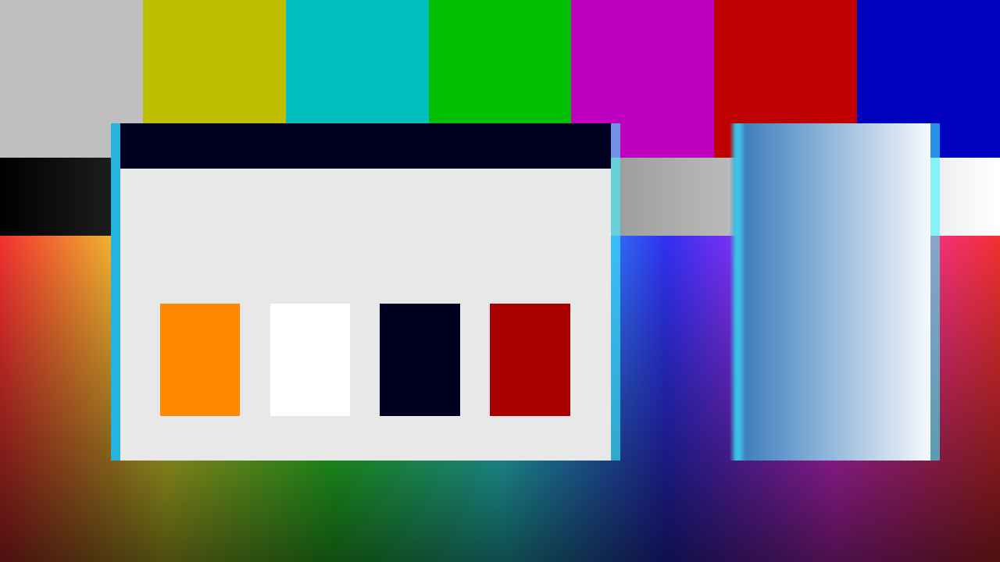
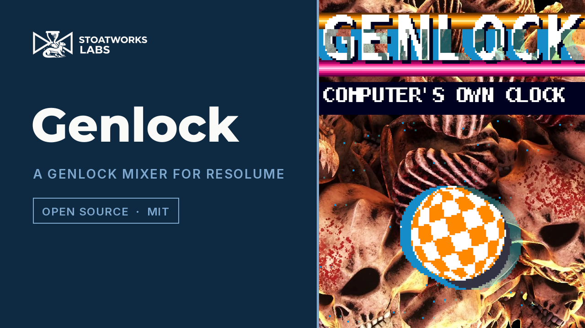

# Genlock

> **AI-assisted project.** This codebase was created with [Claude](https://claude.com/claude-code)
> (Anthropic), directed and reviewed by a human author. It has **never been loaded into
> Resolume on macOS**. On Windows, Arena 7.27.1 loads it as a layer blend mode, drives it every
> frame with both inputs and its clock, and binds its Opacity to the layer's opacity fader.
> That's measured from the plugin's own log, on software rendering, with no pixels captured.
> **Arena doesn't show the Key Source control, so in Resolume the key is always Colour 0** (see
> [Status](#status)). The timing model itself is measured by an offline harness that drives the
> real plugin class in a headless GL context, with **two** input textures at two different
> resolutions, checking each claim against an independent statement of the same arithmetic;
> the results are in the tables under Status. It's the fleet's first FFGL *mixer*. Check it in
> your own rig before you trust it in a show.

An Amiga genlock, flaws and all, as an FFGL **mixer** for
[Resolume](https://resolume.com) Arena and Avenue. It keys the computer's colour 0 over the
layer below on a clock that's a few parts per million out, so you get the fringe, the crawl
and the roll that came free with the original hardware.



<sub>The repo's two test cards through the plugin at a three-pixel key delay,
rendered by `gltest`, the offline harness, rather than captured from Resolume. The band
down every graphic's edges is where the key and the fill disagree: at a left
edge it's the palette's colour 0 laid over the video, at a right edge it's
video cut into the graphic, and Edge Tint has coloured both.</sub>

**[Try it in your browser](https://genlock-demo.stoatworks-labs.com)**: the
plugin's own shader ported to WebGL2, mixing a generated clip (or your own
video) for the layer below with the harness's own test cards for this layer,
with every control. It's a port rather than the plugin, so do read
[what the page itself says it doesn't reproduce](https://genlock-demo.stoatworks-labs.com).

<!-- downloads:start -->

## Download

**[v0.1.0](https://github.com/stoatworks-labs/genlock/releases/tag/v0.1.0)** — prebuilt for macOS and Windows. Pick your platform:

<details>
<summary><b>macOS</b> — Universal (Apple Silicon + Intel)</summary>

| Build | Download | Size |
| --- | --- | --- |
| Universal (Apple Silicon + Intel) · .dmg disk image | [`genlock-0.1.0-macos-universal.dmg`](https://github.com/stoatworks-labs/genlock/releases/download/v0.1.0/genlock-0.1.0-macos-universal.dmg) | 213 KB |
| Universal (Apple Silicon + Intel) · .zip archive | [`genlock-macos-universal.zip`](https://github.com/stoatworks-labs/genlock/releases/latest/download/genlock-macos-universal.zip) | 173 KB |

</details>

<details>
<summary><b>Windows</b> — x64</summary>

| Build | Download | Size |
| --- | --- | --- |
| x64 · .exe installer | [`genlock-0.1.0-windows-x86_64-setup.exe`](https://github.com/stoatworks-labs/genlock/releases/download/v0.1.0/genlock-0.1.0-windows-x86_64-setup.exe) | 221 KB |
| x64 · .zip archive | [`genlock-windows-x86_64.zip`](https://github.com/stoatworks-labs/genlock/releases/latest/download/genlock-windows-x86_64.zip) | 111 KB |

</details>

All builds, checksums and release notes: [github.com/stoatworks-labs/genlock/releases](https://github.com/stoatworks-labs/genlock/releases).

macOS builds are signed and notarised and open normally. The Windows builds are unsigned, so SmartScreen warns once.

<!-- downloads:end -->

## The key comes from the wrong clock

That's the whole design, and everything else follows from it.

An Amiga genlock keys the computer's colour 0 over incoming video, and the video
sets the timing. **The computer doesn't follow it**, though: the key is cut on the
Amiga's own pixel clock, which free-runs a few parts per million away from the
video's. So the key edge arrives a pixel or so away from the fill it belongs to, and
because the two clocks differ, that error walks.

- **A coloured fringe** down one side of every overlay edge. Where the key says
  "computer" and the fill is still colour 0, the palette's background lands on
  the video. Where it says "video" and the fill is already the graphic, video
  cuts into the graphic. Which one you get is the **sign** of `Key Delay`, and
  both happened on the real kit.
- **The fringe crawls.** `Clock Error` is in parts per million, and the crawl
  rate falls out of it: the Amiga's 7.09379 MHz lores pixel clock times the
  fractional error. A real genlock re-locks on every line sync, so only the
  remainder survives. The fringe walks as far as `Crawl Wrap` allows (one
  Amiga pixel by default) and snaps back, over and over. At 0.01 ppm one lores
  pixel takes fourteen seconds; at 50 ppm, an ordinary crystal's tolerance, it's
  a blur.
- **Loss of vertical lock.** Drop `Sync Quality` below half and the overlay
  rolls at `Roll Rate` and tears at the seam. The video stays put, because it's
  the overlay that has lost lock.
- **A three-position fader**, because that's what the hardware had: Video,
  Overlay, Dissolve, and a dissolve pot.

If you want a keyer that behaves itself, that's
[resolume-luma-keyer](https://github.com/stoatworks-labs/resolume-luma-keyer). This one is
here for the flaws.

**It's a mixer rather than an effect.** It needs a layer below it: that layer is the
incoming video, and the clip on this layer is the computer's picture. In
Resolume a mixer is chosen as a layer's **Blend Mode** (the same list serves as
the transition list), so set the upper layer's Blend Mode to SW Genlock.

User guide: [docs/USER-GUIDE.md](docs/USER-GUIDE.md), also at
https://stoatworks-labs.com/software/genlock/guide/

[](https://www.youtube.com/watch?v=g_ieK_B1WiU)

*[Watch it](https://www.youtube.com/watch?v=g_ieK_B1WiU) (52 seconds): colour
0 keyed out to show the video, Key Delay spilling colour 0 one side and
cutting video in on the other, the fringe crawling on a clock a few ppm off,
Amiga Mode's lores, hires and superhires, the overlay losing lock and rolling,
and the three-position fader. It's all the plugin's own output. An FFGL plugin
doesn't have a window to film, so the footage comes from this repo's offline
harness (`gltest --pipe`, driven by a cue sheet) rather than a screen; the video
is Resolume's bundled demo media and the overlay is drawn by the render script.*

## The controls

**Key:** Key Source (Colour 0, Luma or Alpha), Key Colour as a swatch (the
default is Workbench blue, `#0055AA`), Tolerance, Softness and Invert. Arena
7.27.1 doesn't expose Key Source, so in Resolume the key is always Colour 0
(see [Status](#status)).

**Timing:** Amiga Mode (Lores, Hires or Superhires), Key Delay (−8 to +8
Amiga pixels, signed; negative lays colour 0 over the video, positive cuts video
into the fill), Clock Error (0.01 to 50 ppm, geometrically), Crawl Rate, Crawl
Wrap (1 to 16 Amiga pixels: how far the fringe walks before the line sync
pulls it back; one is a genlock that re-locks cleanly, sixteen is the length
of the PAL colour burst it locks to), Sync Quality and Roll Rate.

One Amiga pixel is 1/320 of the picture width in lores, 1/640 in hires and
1/1280 in superhires, at every raster. An Amiga line is that many pixels
across the active picture whatever the monitor is, so a one-pixel fringe is the
same fraction of the frame at 720p and at 4K. The mode decides what an "Amiga
pixel" means, and it only moves what the computer counts in its own pixel
clocks: Key Delay and Crawl Wrap are half the distance in hires and a quarter
in superhires. The crawl's *speed* across the picture and the tear's throw are
time errors in the incoming video, so they're the same in every mode. The defaults
(lores, a one-pixel wrap) render exactly what the plugin rendered before
either control existed.

**Fader:** the three-position switch, and the Dissolve pot that only exists at
the Dissolve position.

**Look:** Fringe and Edge Tint, which colour the band where the key and the
fill disagree (the disagreement is there without them; real hardware puts chroma
crosstalk on it, and this is where you say how much), and Opacity, which in
Resolume is the layer's own Opacity fader, measured on Arena 7.27.1.

## Build

You'll need CMake and the Resolume FFGL SDK, which is a submodule.

```bash
git clone --recursive https://github.com/stoatworks-labs/genlock
cd genlock
cmake -B build -DCMAKE_BUILD_TYPE=Release
cmake --build build
cmake --install build    # → ~/Documents/Resolume Arena/Extra Effects
```

macOS builds universal (arm64 + x86_64) by default. Add
`-DCMAKE_OSX_ARCHITECTURES=arm64` for a quicker development build.

The install path is **Extra Effects**, even though this is a mixer. Resolume has one
FFGL folder, and sources, effects and mixers all load from it: Arena 7's binary
names no other, and the FFGL SDK sends its own mixer example there. I checked on
Windows too (Arena 7.27.1, 2026-09-23): there's no `Extra Mixers` folder, and
`Genlock.dll` in Extra Effects loaded and registered as a mixer. (Before
v0.1.0 this said `Extra Mixers`, which Arena never reads.)

## Building and testing

The harness renders the real plugin class headlessly. It's the first in this
fleet to drive **two** inputs (`--input-a` is Dest, the layer below;
`--input-b` is Src, this layer), and they can be different sizes, with different
hardware padding, rendered to an output that's a third size again.

    ./build/gltest --out /tmp/frame.png     both cards, through the plugin
    ./build/gltest --list                   every parameter, kind and default
    ./build/gltest --mixer                  two inputs, two MaxUVs, and the guards
    ./build/gltest --delay                  the key's lag behind the fill
    ./build/gltest --crawl                  the delay walking, against the closed form
    ./build/gltest --roll                   the roll and its wrap, at two rasters
    ./build/gltest --fader                  what "the output IS Dest" is worth
    ./build/gltest --modes                  what Amiga Mode and Crawl Wrap scale, at two rasters
    ./build/gltest --defaults               the new controls' defaults ARE the old behaviour
    ./build/gltest --mutation               one character of the shipped GLSL fails a check
    ./build/gltest --bench                  720p through 4K
    ./build/gltest --pipe --pipe-src F      two raw RGBA streams in, frames out (filming, not a check)
    python3 tools/sweep.py                  no control is silently dead
    tools/verify.sh                         all of it, on a fresh universal build

Every tolerance in there is derived from something physical (one output texel,
one source texel, one 8-bit code, the raster's own height) rather than from the
number this machine printed first. A whole-texel displacement translates an
image exactly and is asserted as **byte equality**; a fractional one only exists
in the filter's interpolation and gets a derived tolerance. They're never
checked by the same measurement. [AGENTS.md](AGENTS.md) lists every number and
where it comes from.

## Status

**Released at v0.1.0 on 2026-09-23, and still early days.** Verified by
measurement on an Apple M4 Max, macOS 26.4.1, 2026-09-22; the Amiga Mode and
Crawl Wrap rows, the CI rows and the Windows host row on 2026-09-23 (what Arena
does with it once it's chosen is the table after this one):

| Check | Result |
| --- | --- |
| Two inputs, two sizes, two MaxUVs | Dest 200×120 of 256×256, Src 96×70 of 128×128, out 320×200: **0 padding pixels** reached the picture, every quadrant within **0.000 of 255**, a known marker within **0.0006** of the picture (tolerance: one source texel) |
| The missing-input guards | a null input array, zero inputs, one input, a null Dest and a null Src all return `FF_FAIL` without crashing |
| Key delay, whole pixel | a 4-texel change translates the key **exactly — 0 of 164 bytes differ** |
| Key delay, fractional | half a texel recovered from partial coverage at **0.4941 against 0.5000**; tolerance 0.25, derived bound 0.031 |
| The fill does not move | **0 bytes** across three delays past the edge, **0 bytes** over the whole frame with the key off, and at zero delay the fringe provably does nothing |
| Crawl | at 1.127747 ppm the predicted rate is **7.999999 Amiga px/s**; the reduced phase matches the closed form to **0.000e+00** and the key edge to **0.0176 output texels** over 30 frames, wrapping **3 times** as predicted |
| Roll | at **two rasters** — 640×360 (6 whole rows/frame, 23 of 23 exact rotations) and 480×270 (4.5 rows/frame, 11 exact and 12 fractional) — worst **0.0000 rows**, tolerance 0.05; byte-identical after one period |
| Loss of lock | a branch, not a fade: locked, two frames a second apart are byte-identical |
| Fader at Video | **bitwise** Dest, 0 bytes, at matched rasters — for a stated reason. At an unmatched raster it is a resample and no claim is made |
| Amiga Mode: the crawl | its speed across the picture is **bit-identical** in lores, hires and superhires — in the arithmetic, in the plugin's own phase, and in the rendered frames byte for byte over 24 frames — and follows the lores physics to **0.0083 texels** at 640×360 and **0.0619** at 320×180 |
| Amiga Mode: Key Delay | −8 of the mode's pixels moves the key **−16.0024 / −8.0024 / −4.0024** texels at 640×360 (predicted −16 / −8 / −4), and hires at −8 is lores at −4 **byte for byte** |
| Amiga Mode: the tear | the same throw in every mode: **−28.1294** texels at 640×360 against −28.1333 predicted, and the torn frames identical |
| Crawl Wrap | at 4 pixels of the mode: **3** wraps in lores and **6** in hires over 60 frames, as predicted; the key walks **7.933 of 8.000** texels before it snaps |
| Negative controls | each of the four mode claims re-run against a plugin with the wrong answer built in **fails in the picture**, at both rasters; a one-character mutation of the shipped GLSL fails the Key Delay check |
| The defaults are the old plugin | the crawl and delay match the pre-feature formula **bit for bit** over 60 frames; and against the previous commit's own harness, eight scenes rendered **byte-identical PNGs** (checked once, by hand) |
| No dead controls | all **21** sweepable of the 26 parameters measurably change the picture, at 480×270 and 320×180; the other five are the About text and its buttons, which `tools/sweep.py` skips |
| macOS binary | a local build is universal (`x86_64 arm64`), exports `plugMain`, and ad-hoc signs |
| Host metadata | `oxbow probe` reads **SW Genlock / GL01 / mixer / inputs 2..2 / 26 params**, and loading it that way writes the load-time log line naming the bundle |
| A second rasteriser | GitHub's macOS runner has **no GPU**, so the harness ran on Apple's software renderer: all **9** ctest suites (names, mixer, delay, crawl, roll, fader, modes, defaults, mutation) and the sweep at 320×180 **passed** |
| Windows build | the x64 DLL **compiled with MSVC** on GitHub's Windows runner |
| Windows host | Resolume Arena **7.27.1**, Windows x64 (Mesa llvmpipe): `Genlock.dll` in Extra Effects **loaded** and registered as `'SW Genlock' uid: GL01 category: 2` — the category Resolume's own blend modes and transitions register under — and **SW Genlock is in every layer's Blend Mode list**. There is no Extra Mixers folder on Windows either |
| Render cost | **under 0.12 ms/frame at 4K** — 0.7% of a 60 fps frame. One pass and three texture fetches is so cheap that repeated runs vary by a factor of two (0.04 to 0.12 ms at 4K, 0.024 to 0.036 at 1080p); the figure worth quoting is the ceiling, not a mean |

Run `tools/verify.sh` before you believe any of it.

**How Arena drives it, measured 2026-09-23** in Resolume Arena 7.27.1 (build
15990) on win-lab (Windows x64, Mesa llvmpipe, no GPU), with a CI (MSVC) build
of the v0.1.0 source. SW Genlock was set as layer 2's Blend Mode over layer 1, both
layers carrying a still picture, driven through Arena's REST API, and the
plugin's own log (`%LOCALAPPDATA%\genlock\logs\genlock.2026-09-23.log`) read
back. It was a manual probe, because the fleet's Arena gate can't gate a mixer: it
only knows registration categories 1 and 3, looks for the plugin in the source list,
and can only mount a clip effect or a source.

| Question | Measured answer |
| --- | --- |
| Does it load, and as what? | Yes: Arena scans Extra Effects and loads `Genlock.dll` at scan time; it registers as category 2, beside Resolume's own blend modes |
| Is it instantiated as a blend mode? | Yes: `instance created`, InitGL at **1280×720** (the composition size), host `Resolume Arena 7.27.1 15990`, `SetSampleRate 44100` |
| What do the two inputs look like? | `Dest 1280x720 of 1280x768, Src 1280x720 of 1280x768` — **both padded**, so MaxUV.y is not 1 in a real host and the per-input MaxUV handling is exercised |
| Does Resolume drive a mixer's clock? | **Yes**: `SetTime` before frame 1 and on every frame (412 calls over 412 frames), in **milliseconds** since Arena started (about 4.1e6; the unit detector voted ms 4–0). `SetBeatInfo` every frame (128 bpm) |
| Is a mixer called with one input while patching? | **Not observed.** Clearing the layer below and refilling it gave no `guard:` line: Arena kept passing two inputs, the lower layer's empty composite. An empty bottom layer from the start was not tried |
| Is `Opacity` bound? | **Yes — to the layer's Opacity, not the transition.** The log followed the layer's opacity 1 → 0.42 → 1 (`Opacity 1 at frame 1`, `0.42 at frame 78`, `1 at frame 204`); writing the mixer's own Opacity (0.61, then 0.13) never reached the plugin, and Arena read it back as 0.42. Whether the layer's transition or autopilot also drives it was not tested |
| Are the parameters all there? | **25 of 26.** Every name, type and default in Arena's mixer panel matches the declaration, except that **Key Source is not exposed at all** |

**Known limitation: in Resolume, Key Source is stuck at Colour 0.** Arena's
mixer panel leaves out Key Source (the first declared parameter, id 0), so the
key is always the default Colour 0 there, and Luma and Alpha keying can't be
reached. I don't know why (one guess: Arena treats a mixer's first parameter
specially). It was found on Windows; I haven't looked on macOS.

What that run did **not** show is a picture: a mixer's output only exists in the
composition, and Arena's REST thumbnails don't serve it. So I'm not claiming it
"renders correctly in Arena", only that it initialised and was called every frame
with no error lines.

**Not done yet, and it's a long list.** It has **never been loaded into
Resolume on macOS**, and no frame of its output in Resolume has been looked at.
Whether a mixer is ever called with one input (the SDK example's claim) and
whether the layer's transition moves `Opacity` are still open. The CI run proves
the checks on a second rasteriser, and the Arena run above was on software
rendering; the render cost is still macOS-only. The
universal build has never run on an Intel Mac. Premultiplied alpha is assumed
rather than measured. The **tear** at the roll seam is a look rather than a model:
nothing measures it and no real hardware was consulted. There are **no
presets** and no OpenFX port. The [browser demo](https://genlock-demo.stoatworks-labs.com)
runs the plugin's shader but not the plugin, and says how it differs.

**Amiga Mode and Crawl Wrap come from arithmetic, not observation.** The rule (pixel
clocks scale with the mode, time errors don't) is argued in `Controls.h` and
measured against itself. Nobody has compared a hires Workbench through a real
genlock, and a composite-rate genlock's actual bandwidth may make superhires look
nothing like a quarter-size lores fringe. The 16-pixel ceiling on Crawl Wrap is
derived from the length of the colour burst, not measured on any genlock. PAL
only: no NTSC.

**The log answered most of it.** It records where the host loaded the bundle
from, the host's name and version, whether a mixer is called with one input,
whether its clock is driven and in what unit, and every change to `Opacity`.
The first Arena session (above) settled the clock, the inputs and the `Opacity`
binding; the one-input call and the transition are still open.
[AGENTS.md](AGENTS.md) says what each line answers.

[AGENTS.md](AGENTS.md) has the full list of what's assumed rather than
measured, the open questions, the traps, and the fleet's only written account of
how an FFGL mixer actually behaves.

<!-- attributions:start -->
This project is built on other people's work — see [ATTRIBUTIONS.md](ATTRIBUTIONS.md).
<!-- attributions:end -->

## Licence

MIT — see [LICENSE](LICENSE) and [ATTRIBUTIONS.md](ATTRIBUTIONS.md).
